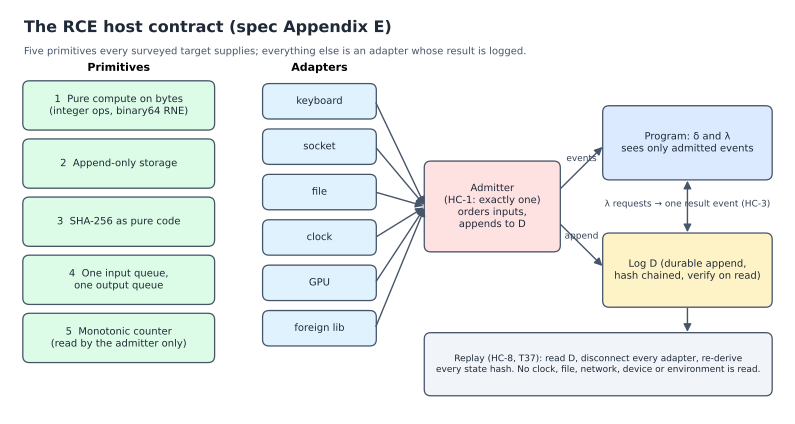
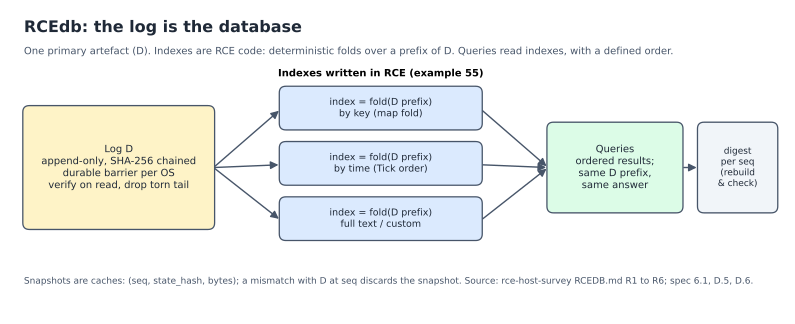

# RCE

RCE is a small programming language defined by a written specification.
Every program is given one meaning, a *Form*: a state machine made of
states, events, a step function that maps a state and an event to a new
state and its outputs, and the log of events. This repository holds the
specification (draft 0.9), its grammar in EBNF, and `rce`, the reference
checker and interpreter that decides which programs are accepted and what
they do. Since 23 October 2026 it also holds everything that must agree
with the specification: the grammar package for editors, The RCE Book, the
example programs, the standard library, the conformance suite and the IDE.
They were separate repositories; they are now directories of this one,
checked from the same commit, so none of them can lag the language.

In plain words:

1. **A program gives the same answer on every computer.** Arithmetic, text
   and floating point each have one defined result, so nothing depends on
   the machine or the compiler.
2. **Every program finishes.** Loops have limits and recursion must work on
   smaller and smaller parts of its input, so a program cannot hang.
3. **Mistakes are caught before the program runs.** Using memory after
   giving it away, forgetting a case, or writing a test that does not hold
   makes the checker refuse the program, and it names the rule that was
   broken.

## At a glance


*The pipeline. The checker accepts a program or names the rule it breaks; an accepted program is a Form P = (S, E, δ, D, λ); every step is appended to the hash-chained log D; `rce emit` projects the program to Rust, Python, JavaScript or Scala; a host runs it on a compute fabric.*

| Host contract (Appendix E) | RCEdb: the log is the database |
|---|---|
|  |  |
| Five primitives every surveyed target supplies; everything else is an adapter whose result is logged by the single admitter, and replay runs with every adapter disconnected. | D is the one primary artefact. Indexes are deterministic folds written in RCE (example 55); queries read them in a defined order. |

More figures (host survey, no-code survey, emit target selection, failure-class matrix), with captions, scripts and data: [docs/figures](docs/figures/). Figures marked [opinion] there encode the author's judgement.

## Try it in the browser

The [RCE playground](https://openie-dev.github.io/rce/) runs this checker, compiled to WebAssembly, in your browser: type a program and see whether it is accepted, which rule it breaks, and the trace of each `example`. Nothing to install. To run `fn main()` or emit code, install `rce` below.

## Install

`rce` is built from source. You need [Rust](https://rustup.rs); the
version used is pinned in `spec/checker/rust-toolchain.toml` (1.98.1) and
`rustup` installs it on first build. Prebuilt `rce` binaries (with the desktop IDE) are on the [rce-ide releases page](https://github.com/openIE-dev/rce-ide/releases/latest).

```sh
git clone https://github.com/openIE-dev/rce
cd rce/spec/checker
cargo build --release
install -m 755 target/release/rce ~/.local/bin/
```

The default build needs a C compiler only for `ring`, the crypto provider of the TLS adapter (Xcode command line tools on macOS, `build-essential` on Debian and Ubuntu).

## Quickstart

Save this as `counter.rce`:

```
intent "a counter that never goes below zero"
    example Inc, Inc, Dec -> 1
    example Dec -> refused: Underflow

state Counter
    n: u64 = 0

event Inc
event Dec

error Underflow

step Counter on Inc -> n + 1
step Counter on Dec -> try n.checked_sub(1) else Underflow
```

Check it, run its tests, and apply some events:

```text
$ rce test counter.rce
ok counter.rce (2 examples, 0 checks)
1 passed, 0 failed

$ rce run counter.rce "Inc, Inc, Dec, Dec, Dec"
0 (initial) Counter { n = 0 }
1 Inc Counter { n = 1 }
2 Inc Counter { n = 2 }
3 Dec Counter { n = 1 }
4 Dec Counter { n = 0 }
5 Dec refused: Underflow
```

The two `example` lines are part of the program: if either one did not
hold, `rce check` would refuse the file. To learn the language step by
step, read [The RCE Book](book/) (published at [openie-dev.github.io/rce/book](https://openie-dev.github.io/rce/book/)).

## Commands

| Command | What it does |
|---|---|
| `rce check FILE...` | parse, type check and admit; one verdict per file |
| `rce test FILE...` | the same, and count each file's examples and checks |
| `rce run FILE [EVENTS]` | apply events, or run `fn main()` |
| `rce trace --json FILE [EVENTS]` | reference trace of each example, or of EVENTS, for checking another implementation step by step |
| `rce emit TARGET FILE` | `form` (the Form as JSON), `rust`, `python`, `js` or `scala` |
| `rce fmt [--check] FILE...` | rewrite files in the canonical layout |
| `rce dim [--fuel N] [--control] [--json] FILE` | count the behaviours a program can be in and the redundancy of its state (spec 6.10, 10.11) |
| `rce lsp` | language server on standard input and output |
| `rce --version` | the checker version, the specification draft and the language versions it accepts |

Section 10 of the specification defines each command exactly.

## What is in this repository

| Path | Contents |
|---|---|
| `spec/book/` | the specification, one chapter per file; start at `00-overview.md` |
| `spec/RCE-SPEC.md` | the same specification as one file, generated from `spec/book/` |
| `spec/book/03-syntax.md` | the normative grammar, in EBNF, read directly by the tools |
| `spec/examples/` | programs that must be accepted, and in `reject/`, `ill_typed/` and `inadmissible/`, programs that must be refused |
| `spec/checker/` | the reference parser, type checker, interpreter, emitters, formatter and language server (Rust) |
| `spec/checker-wasm/` | the same checker compiled to WebAssembly for the browser |
| `tree-sitter/` | the tree-sitter grammar package (grammar, generated parser, queries, bindings), used by the checker as an independent second parser |
| `spec/lean/` | the Lean 4 model of the core language and its proofs (section 8) |
| `spec/fuzz/` | results of the grammar-level program fuzzer |
| `spec/LANGUAGE-REVIEW.md` | what RCE learned from Rust, Go, Python, Mojo, Zig and Haskell; drafts 0.4 and 0.5 follow it |
| `spec/book/16-host-contract.md` | Appendix E, the host contract: one admitter, durable append per OS, fatal storage barrier, verify on open, inputs as events, capabilities, fabric entries and automatic placement, and RCEdb written in RCE (theorems T37 to T39, `spec/lean/RCE/Host.lean`, `spec/checker/tests/host_contract.rs`) |
| `spec/data/` | the specification as data (grammar tables, rules, method and cost tables), read from the book by `rce-spec-data` |
| `spec/traces/` | reference traces of the example corpus (`rce trace --json`) |
| `spec/conc06/`, `spec/conc06b/` | test programs for the version 0.6 extensions of Appendix C |
| `spec/checker-wasm/pkg/` | the built WebAssembly package (wasm-pack) |
| `spec/wasm-test/` | Node test of the WebAssembly package against the examples |
| `spec/checker/src/host.rs`, `adapters.rs`, `sandbox.rs`, `tls.rs`, `rcedb.rs` | the host runtime of Appendix E (`rce host`): the admitter and log, adapters (files, network, PTY terminal, media, foreign wasm), the OS sandbox, mutual TLS between hosts, and RCEdb |
| `lib/` | libraries written in RCE: `crypto.rce` (SHA-2, X25519, Ed25519, X3DH, double ratchet), `hpke.rce` (RFC 9180), `mls.rce` (RFC 9420 key schedule), `pq.rce` (ML-KEM) |
| `apps/` | applications in RCE run by `rce host`: end-to-end encrypted chat, an SFU and a terminal |
| `rcedb/` | RCEdb, the log-as-database indexes, written in RCE |
| `examples/` | further example programs (Form, surface and ingest examples) |
| `scripts/` | helper scripts: proofs, Lean audit, cross-architecture hashes, the chat demo |
| `book/` | The RCE Book (mdBook): the language from first principles, every listing checked (`book/scripts/check-listings.sh`); published at [openie-dev.github.io/rce/book](https://openie-dev.github.io/rce/book/) |
| `programs/` | example programs by area (body, data, money, network, science, systems, text, world, hardware, media) and the ecosystem programs; formerly rce-examples |
| `stdlib/` | the standard library (`stdlib/lib/`), its vectors and checks; formerly rce-stdlib |
| `conformance/` | the implementation-independent conformance suite, its harness, adapters and reports; formerly rce-conformance |
| `ide/` | the editor, language server, MCP server and sandbox, built on `spec/checker` as a path dependency; formerly rce-ide |
| `playground/` | the browser playground, published with the book by `pages.yml` |

## Status

The specification is **draft 0.9, published for review** (the version
string printed by `rce --version` and the overview of `spec/book/00-overview.md`
are the same draft). It can still
change. The reference interpreter defines what programs mean and is not
built for speed. There is no production compiler yet. Section 10.8 lists
what the tools do not do yet. Counts quoted about the specification and the
checker are taken from the source by `scripts/claim-counts.py --check`; a
count is not a test result, and test results come from running the tests.

## Language versions 0.5, 0.6, 0.7 and 0.8

Each module selects its language version with a first-line comment
(section 2.7). A module without it is version 0.5, the language of
sections 2 to 10. A module that starts with

```
# rce-version: 0.6
```

also gets Appendix C (`spec/book/14-draft06-concurrency.md`): `par`,
`for ... par`, `with budget`, workgroups, LVars, sessions, supervisors and
the cost table of C.6.4. Version 0.7 (`# rce-version: 0.7`, C.15) is 0.6
with one difference: a standard library method costs its size-scaled work
in addition to the call, so only where a budget traps can change. The
version of the module that contains a call expression decides that cost,
so modules of different versions can be joined with `use`. Appendix D
(`spec/book/15-handler-spec-profile.md`) defines handler specs and fits.
A version 0.5 module never sees Appendix C, so every valid 0.5 program is
accepted unchanged. Version 0.8 (`# rce-version: 0.8`, C.16, section 5.16)
is 0.7 plus indexed values: context-typed text `Text[Html]`, `Text[Url]`,
`Text[Sql]` and `Text[Json]` (made only from literals or by `encode`, so
data never forms markup or a query), `Secret[τ]` (opaque, compared only by
equality, never emitted), `Cap[A]` (authority carried by an event) and
`Guarded[τ, A]` state fields (written only by steps whose events carry
`Cap[A]`). In every version, refined types `type R = τ where p` (5.1,
W-REF-1) check a decidable predicate wherever the declared range is
checked, and functions may be mutually recursive when a summed measure
falls on every call or a bound is declared (`fn … bound n`, 6.7,
W-REC-1). The cargo feature `conc06` is a development aid only:
it reads undeclared modules as 0.6 for the draft's test corpora and
enables the 0.6 test suites.

```sh
cargo test --release --features conc06
```

## How the specification is checked

```sh
cd spec/checker
cargo run --release --bin rce-spec-check
```

This reads the grammar from `spec/book/03-syntax.md`, builds LALR(1)
tables and fails on any conflict, parses every example with two parsers
that must agree, runs the checker over all accepted and refused examples,
and checks that `RCE-SPEC.md` matches the chapters. With
`--features tree-sitter` (needs a C compiler and the
[tree-sitter CLI](https://tree-sitter.github.io/)) it also regenerates the
tree-sitter parser and uses it as a third parser. `cargo test --release`
runs the checker's own tests, including the emitter tests, which need
`rustc`, `python3` and `node` (a missing one is reported as skipped).

## One repository, maintained together

Everything that must agree with the specification lives in this repository
and is checked from the same commit, so nothing is pinned to an older
`rce` and nothing is vendored. Each directory has one workflow in
`.github/workflows/` that builds the checker from the current commit and
runs that directory's checks against it:

| Directory | What it is | Checked by |
|---|---|---|
| `spec/` | the specification, the reference checker and interpreter, the Lean core, the example corpora, the canonical vectors | `ci.yml`, `tree-sitter-sync.yml`, `xarch-parity.yml` |
| `tree-sitter/` | the grammar package for editors: `grammar.js`, the generated parser, queries, bindings, corpus tests; the checker's independent second parser | `tree-sitter.yml` (package), `tree-sitter-sync.yml` (agreement with the Rust parser over every `.rce` file) |
| `book/` | The RCE Book, mdBook, every listing checked | `book.yml`; published under `/book/` by `pages.yml` |
| `programs/` | example programs by area, and the ecosystem programs | `programs.yml` |
| `stdlib/` | the standard library and its vectors | `stdlib.yml` (nightly: the slow vector sets) |
| `conformance/` | the implementation-independent conformance suite and its adapters | `conformance.yml` |
| `ide/` | the editor, LSP, MCP server and sandbox, a path dependency on `spec/checker` | `ide.yml`, `ide-release.yml` (tags `ide-v*`) |
| `playground/` | the browser playground | `pages.yml` |

Until 23 October 2026 the book, programs, standard library, conformance
suite, grammar package and IDE were separate repositories
(`rce-book`, `rce-examples`, `rce-stdlib`, `rce-conformance`,
`tree-sitter-rce`, `rce-ide`); their histories were merged here. The
research site and the experiments
([research-openie-web](https://github.com/openIE-dev/research-openie-web),
[openie-research-experiments](https://github.com/openIE-dev/openie-research-experiments))
stay separate: they read this repository, this repository never reads them.

## Contributing

See [CONTRIBUTING.md](CONTRIBUTING.md). Everyone taking part follows the
[code of conduct](CODE_OF_CONDUCT.md).

## License

Copyright (c) 2026 Open Interface Engineering, Inc.

Licensed under either of

- Apache License, Version 2.0 ([LICENSE-APACHE](LICENSE-APACHE))
- MIT license ([LICENSE-MIT](LICENSE-MIT))

at your option. Unless you explicitly state otherwise, any contribution
you intentionally submit for inclusion in this work shall be dual licensed
as above, without any additional terms or conditions.
