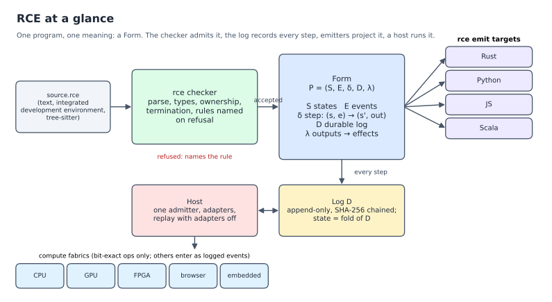

# RCE: the Reality Code Engine

RCE stands for **Reality Code Engine**. It is a programming language and
toolchain in which every program has one fixed, checkable shape, so that
programs can be written, checked, changed and run by machines without a
language model in the loop.

## Why RCE exists

RCE is made for the AI coding era. Models now write most of the code that
gets written, and they write it in languages designed for people: text
whose meaning depends on the compiler, the platform, the library versions
and the flags, and whose correctness is checked after the fact by tests,
reviews and more model calls. Every one of those steps spends energy and
tokens on resolving ambiguity that the language itself introduced, and
none of them can promise that the result is right.

RCE removes the ambiguity at the source. A program is a *Form*: a state
machine P = (S, E, δ, D, λ) of declared states, declared events, a pure
step function from a state and an event to the next state and its outputs,
and the hash-chained log D of every event applied. Everything the program
can do is in the Form, and the checker either admits the Form or names the
rule it breaks. The `example` lines a program carries are part of it, and
a program whose examples do not hold is refused before it runs.

This is what makes autonomous coding deterministic. A proposal, whether a
person, a search over existing Forms or a model produced it, is accepted
or refused by the checker alone, with the same verdict on every machine.
Once accepted, the Form replays identically everywhere, projects to Rust,
Python, JavaScript or Scala without changing meaning, and is reused as a
whole. No model is needed to decide what a program means, whether a change
is safe, or whether two programs are the same, so the costly and
non-deterministic part of AI coding is taken out of the loop. The aim is
the lowest cost and lowest energy per correct program.

What the language guarantees:

1. **A program gives the same answer on every computer.** Arithmetic, text
   and floating point each have one defined result, so nothing depends on
   the machine or the compiler.
2. **Every program finishes.** Loops have limits and recursion works on
   smaller and smaller parts of its input, so a program cannot hang.
3. **Mistakes are caught before the program runs.** Using memory after
   giving it away, forgetting a case, or writing an `example` that does not
   hold makes the checker refuse the program, and it names the rule that
   was broken.
4. **There is one language.** The specification at one commit is the
   language, every module of a program is in it, and nothing in this
   repository depends on a released or pinned version of anything else in
   it. A program never breaks because a library or a tool moved.

## What is here

This repository holds everything that defines, implements, teaches,
exercises or must agree with the language: the specification, the
reference checker and interpreter, the Lean proofs, the grammar package,
the book, the standard library, the example programs, the conformance
suite, the IDE and the playground. All of it is built and checked from the
same commit.



*The checker accepts a program or names the rule it breaks; an accepted program is a Form; every step is appended to the log D; `rce emit` projects the program to Rust, Python, JavaScript or Scala; a host runs it on a compute fabric.*

## Try it

The [playground](https://openie-dev.github.io/rce/) runs the checker,
compiled to WebAssembly, in the browser. [The RCE Book](https://openie-dev.github.io/rce/book/)
teaches the language from first principles.

## Build

`rce` is built from source with [Rust](https://rustup.rs); `rustup` reads
`spec/checker/rust-toolchain.toml` and installs the toolchain on first
build. The default build needs a C compiler only for `ring`, the crypto
provider of the TLS adapter.

```sh
git clone https://github.com/openIE-dev/rce
cd rce/spec/checker
cargo build --release
install -m 755 target/release/rce ~/.local/bin/
```

Prebuilt `rce` binaries with the desktop IDE are on the
[releases page](https://github.com/openIE-dev/rce/releases).

## Quickstart

Save this as `counter.rce`:

```
intent "a counter that never goes below zero"
    example Inc, Inc, Dec -> 1
    example Dec -> refused: Underflow

state Counter
    n: u64 = 0

event Inc
event Dec

error Underflow

step Counter on Inc -> n + 1
step Counter on Dec -> try n.checked_sub(1) else Underflow
```

```text
$ rce test counter.rce
ok counter.rce (2 examples, 0 checks)
1 passed, 0 failed

$ rce run counter.rce "Inc, Inc, Dec, Dec, Dec"
0 (initial) Counter { n = 0 }
1 Inc Counter { n = 1 }
2 Inc Counter { n = 2 }
3 Dec Counter { n = 1 }
4 Dec Counter { n = 0 }
5 Dec refused: Underflow
```

The `example` lines are part of the program: if one did not hold, the
checker would refuse the file.

## Commands

| Command | What it does |
|---|---|
| `rce check FILE...` | parse, type check and admit; one verdict per file |
| `rce test FILE...` | the same, and count each file's examples and checks |
| `rce run FILE [EVENTS]` | apply events, or run `fn main()` |
| `rce trace --json FILE [EVENTS]` | reference trace of each example, or of EVENTS, for checking another implementation step by step |
| `rce emit TARGET FILE` | `form` (the Form as JSON), `rust`, `python`, `js` or `scala` |
| `rce fmt [--check] FILE...` | rewrite files in the canonical layout |
| `rce dim [--fuel N] [--control] [--json] FILE` | count the behaviours a program can be in and the redundancy of its state (spec 6.10, 10.11) |
| `rce host ...` | run a program under the host contract (Appendix E): admitter, log, adapters, sandbox |
| `rce lsp` | language server on standard input and output |

Section 10 of the specification defines each command.

## Repository

| Path | Contents |
|---|---|
| `spec/book/` | the specification, one chapter per file; start at `00-overview.md`. `03-syntax.md` is the normative EBNF grammar, read by the tools; `16-host-contract.md` is the host contract (Appendix E) |
| `spec/RCE-SPEC.md` | the specification as one file, generated from `spec/book/` by `rce-book build` |
| `spec/checker/` | the reference parser, type checker, interpreter, emitters, formatter, language server and host runtime (Rust); also `rce-spec-check`, `rce-book`, `rce-spec-data` and `rce-fuzz` |
| `spec/checker-wasm/` | the checker compiled to WebAssembly; `spec/wasm-test/` tests the package against the examples |
| `spec/lean/` | the Lean 4 model of the core language and its proofs (section 8); `scripts/lean-audit.sh` checks the axioms |
| `spec/examples/` | programs the checker must accept, and in `reject/`, `ill_typed/` and `inadmissible/`, programs it must refuse |
| `spec/traces/` | reference traces of the example corpus |
| `spec/data/` | the specification as data (grammar tables, rules, method and cost tables) |
| `spec/proposals/` | design proposals and the decision ledger (`LEDGER.md`) |
| `spec/fuzz/` | results of the grammar-level program fuzzer |
| `tree-sitter/` | the tree-sitter grammar package for editors (grammar, generated parser, queries, bindings); the checker's independent second parser |
| `book/` | The RCE Book (mdBook); every listing is checked by `book/scripts/check-listings.sh` |
| `playground/` | the browser playground |
| `stdlib/` | the standard library (`stdlib/lib/`), its vectors and checks |
| `lib/` | libraries written in RCE: `crypto.rce` (SHA-2, X25519, Ed25519, X3DH, double ratchet), `hpke.rce` (RFC 9180), `mls.rce` (RFC 9420), `pq.rce` (ML-KEM) and their companions |
| `rcedb/` | RCEdb: the log as the database, indexes written in RCE |
| `apps/` | applications run by `rce host`: end-to-end encrypted chat, an SFU and a terminal |
| `programs/` | example programs by area (body, data, money, network, science, systems, text, world, hardware, media, multi) and the ecosystem programs |
| `examples/` | Form, surface and ingest examples |
| `conformance/` | the implementation-independent conformance suite, its harness, adapters and reports |
| `ide/` | the editor, language server, MCP server and sandbox, built on `spec/checker` |
| `docs/figures/` | figures with captions, scripts and data |
| `scripts/` | repository scripts: proofs and Lean audit, cross-architecture hashes and determinism streams, the Form corpus generator, claim counts, demos |
| `.github/workflows/` | one workflow per directory; each builds the checker from the current commit and runs that directory's checks against it |

## Checking the specification

```sh
cd spec/checker
cargo run --release --bin rce-spec-check
cargo test --release
```

`rce-spec-check` reads the grammar from `spec/book/03-syntax.md`, builds
LALR(1) tables and fails on any conflict, parses every example with two
parsers that must agree, runs the checker over all accepted and refused
examples, and checks that `RCE-SPEC.md` matches the chapters. With
`--features tree-sitter` (needs a C compiler and the
[tree-sitter CLI](https://tree-sitter.github.io/)) it also regenerates the
tree-sitter parser and uses it as a third parser. The emitter tests need
`rustc`, `python3` and `node`; a missing one is reported as skipped.

## Status

The specification is a draft under review. The reference interpreter
defines what programs mean and is not built for speed; there is no
production compiler. Section 10.8 lists what the tools do not do yet.
Counts quoted about the specification and the checker are taken from the
source by `scripts/claim-counts.py --check`; a count is not a test result.

The research site and the experiments
([research-openie-web](https://github.com/openIE-dev/research-openie-web),
[openie-research-experiments](https://github.com/openIE-dev/openie-research-experiments))
read this repository; this repository never reads them.

## Contributing

See [CONTRIBUTING.md](CONTRIBUTING.md). Everyone taking part follows the
[code of conduct](CODE_OF_CONDUCT.md).

## License

Copyright (c) 2026 Open Interface Engineering, Inc.

Licensed under either of

- Apache License, Version 2.0 ([LICENSE-APACHE](LICENSE-APACHE))
- MIT license ([LICENSE-MIT](LICENSE-MIT))

at your option. Unless you explicitly state otherwise, any contribution
you intentionally submit for inclusion in this work shall be dual licensed
as above, without any additional terms or conditions.
