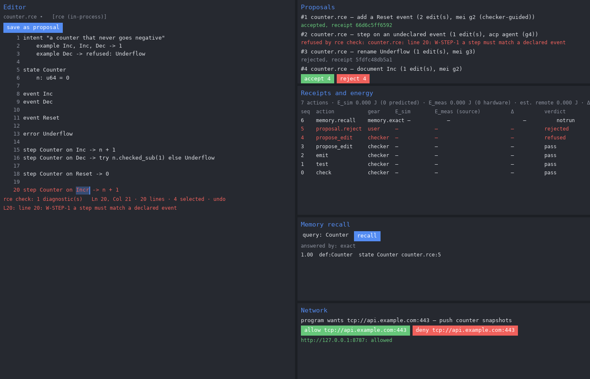

# rce-ide: the RCE IDE agent layer (steps 1 to 3)

Rust only, toolchain 1.98.1. The checker, language server and receipt and energy crates make no model call and no network call. Three crates can: `mei-agent` has HTTP clients for System-One and OpenAI-compatible chat endpoints, `rce-mcp` has a loopback HTTP transport, and `ide-sandbox` has a network proxy behind permission prompts. `acp-client` runs outside coding agents under a jail. Whether any model is called depends on what the user configures, and every proposal still goes through `rce check` before it is accepted.

## At a glance



*The IDE. Left: the editor, with the checker naming the broken rule (W-STEP-1) on line 20. Right: proposals, each accepted by `rce check` or requiring change, with a receipt; the receipt ledger with energy columns (empty where nothing was measured); memory recall; and a network request waiting for permission.*


*Where the IDE sits in RCE: it edits source and calls the reference checker; accepted programs become a Form with a hash-chained log, and `rce emit` projects them to other targets. More figures: [openIE-dev/rce docs/figures](https://github.com/openIE-dev/rce/tree/main/docs/figures).*

- `crates/ide-receipt`: one receipt per action (action kind, gear, model, tokens in/out,
  E_sim, E_meas with source tag `rapl|nvml|powermetrics|jetson|estimated-remote`, delta,
  checker verdict, policy hash), BLAKE3 hash chain, ed25519 signature. JSONL ledger,
  verified in full on open. Mappers from `mol.receipt.v1` and mei-studio `mei-receipt` JSON.
- `crates/ide-energy`: `Simulator` trait and a linear simulator with per-gear/model
  coefficients fitted by least squares; `Meter` trait with Linux RAPL (powercap
  `energy_uj`, wraparound handled), NVML behind `--features nvml`, and macOS / Jetson
  backends that return `Unsupported`; time-window attribution; k-sigma anomaly test.
- `crates/rce-mcp`: stdio MCP server (JSON-RPC 2.0, newline-delimited). Tools
  `read_form`, `propose_edit`, `rce_check`, `rce_test`, `emit`. Uses the RCE reference
  checker (`rce-spec-check`, a path dependency on `../spec/checker`, the reference checker of this repository).

Honesty rules: an uncalibrated simulator predicts `None`; without a readable meter
`e_meas` is `None`; `delta_j` exists only for a hardware measurement and a prediction.

Run: `cargo run -p rce-mcp -- --root DIR [--ledger FILE] [--key FILE] [--calibration FILE]`.

## Source and releases

The IDE is the `ide/` directory of the rce repository (since 23 October
2026). It builds against the reference checker `../spec/checker` of the same
commit as a path dependency, never a vendored or pinned copy, so the IDE and
the specification cannot drift apart. Everything the checker does is public
in this repository: the host runtime (`rce host`, Appendix E), RCEdb
(`rce db`, with `../rcedb/`), the media and redaction options of
`rce host`, the applications in `../apps/` and the standard library in
`../stdlib/`.

The IDE build adds four programs: `rce-ide` (the desktop IDE, wgpu on
Vulkan, Metal, DX12 or GL), `rce` (the reference checker CLI with one
addition of the IDE's own, the energy-budget gate
`rce test FILES.. --energy-budget J [--measured J | --measure] [--strict]`
in `crates/rce-ide/src/ci.rs`; the `rce` of `../spec/checker` does not have
it), `rce-lsp` (language server) and `rce-mcp` (MCP server for agents).

Build from source (Rust 1.98.1, read from `rust-toolchain.toml`):

```sh
git clone https://github.com/openIE-dev/rce
cd rce/ide
cargo build --release -p rce-ide -p rce-mcp
install -m 755 target/release/rce target/release/rce-ide target/release/rce-lsp target/release/rce-mcp ~/.local/bin/
```

Then open a folder of `.rce` files: `rce-ide --root DIR --file main.rce [--history 50]`.

Releases: v0.1.0 to v0.1.3 are on the
[releases page of openIE-dev/rce-ide](https://github.com/openIE-dev/rce-ide/releases),
the repository the IDE lived in before it moved here; they were built from
that repository, not from this directory. New releases are built from this
directory by `.github/workflows/ide-release.yml` and published on the
[releases page of this repository](https://github.com/openIE-dev/rce/releases)
when an `ide-v*` tag is pushed; none has been pushed yet. A release archive
holds the four programs above, the README and the license files; verify it
with `sha256sum -c SHA256SUMS --ignore-missing` (Linux), or
`Get-FileHash rce-ide-*.zip -Algorithm SHA256` (Windows PowerShell) and compare.

Platforms and requirements:

| Archive | Requirement |
|---|---|
| `x86_64-unknown-linux-gnu` | glibc 2.28 or newer; a Vulkan or GL driver (Mesa works, including llvmpipe); X11 or Wayland |
| `aarch64-unknown-linux-gnu` | as above, on 64-bit Arm |
| `x86_64-pc-windows-gnu` | Windows 10 or newer, DX12 or Vulkan |
| `aarch64-apple-darwin` | macOS on Apple silicon; Metal. Ad-hoc signed, not notarized: clear quarantine with `xattr -d com.apple.quarantine rce*` or allow in Privacy and Security |

Notes:

- `rce-mcp --http` jails itself after binding (Landlock + seccomp; loopback or
  `--allow-host` only; outbound only to ports declared in `.rce-ide/net.json`).
  The jail exists on Linux only (kernel 6.7+ for Landlock ABI 4). On Windows and
  macOS HTTP mode does not start unless you pass `--no-jail`; stdio mode is
  unaffected.
- `rce-ide telemetry probe` lists the energy meters and the GPU launch source
  found on this machine. Without a readable meter, energy is reported as
  simulated or missing, never guessed.

Graph view keys (pointer over the graph): F3 view, F4 layout, F6/F7/F8 colour,
size and glow metric (or click the chips), Esc folds expanded files, Shift-drag
a definition onto another file to move it, Delete removes the selected
definition, N adds a function. Every graph edit is written only if `rce check`
admits the program.

## License

Copyright (c) 2026 Open Interface Engineering, Inc. Licensed under either of Apache License 2.0
(LICENSE-APACHE) or MIT (LICENSE-MIT), at your option. The vendored photon
library is MPL-2.0 (source shipped as `photon-source-mpl-2.0.tar.gz`), and
webpki-roots is CDLA-Permissive-2.0; see release/LICENSE-STATUS.md.
